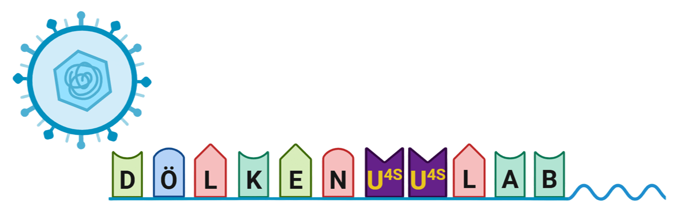
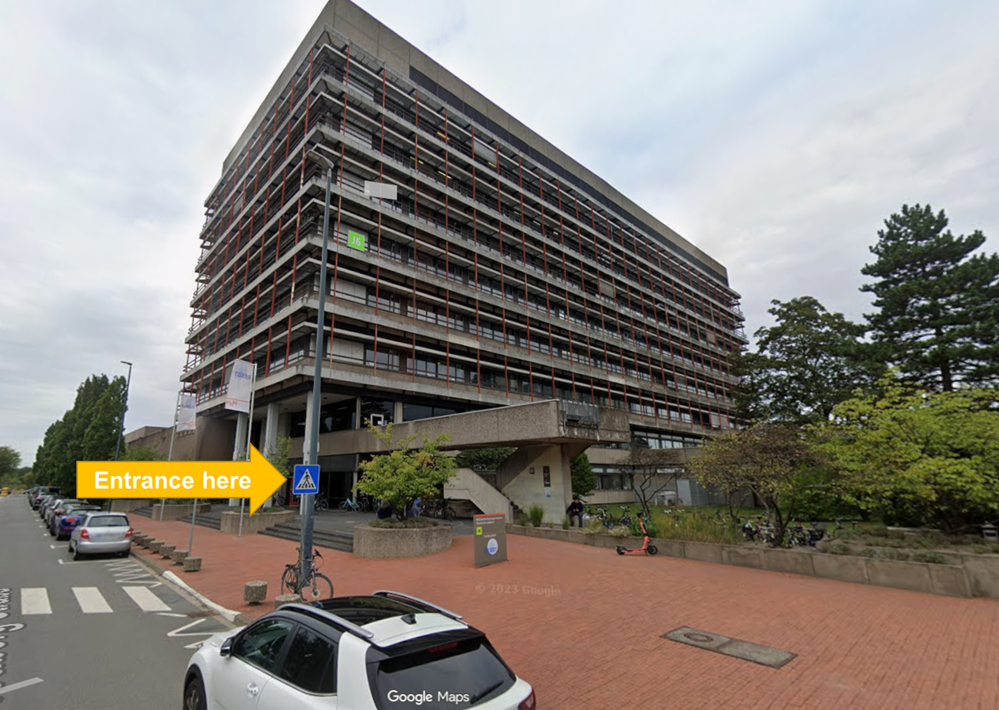
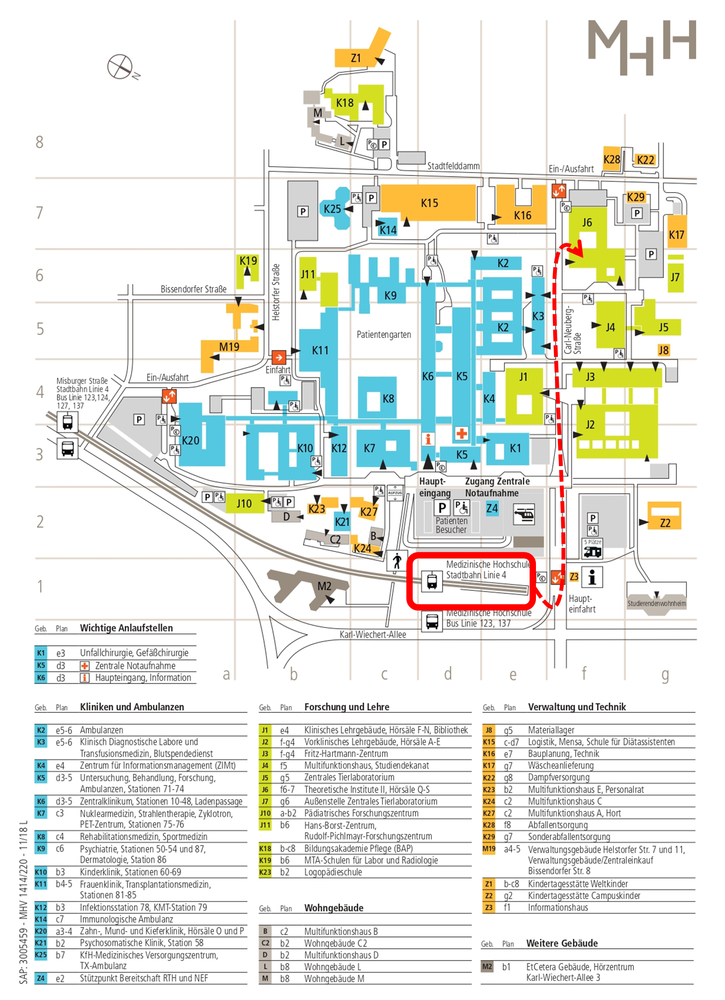

Sie finden uns in Gebäude J6 der [Medizinischen Hochschule Hannover (MHH)](https://www.mhh.de/) am [Institut für Virologie](https://www.mhh.de/virologie), Arbeitsgruppe Dölken [(AG Dölken)](https://www.mhh.de/virologie/forschung/doelken-lab).

## Werden Sie Teil unseres Teams

Wenn Sie Interesse an einer Masterarbeit, einer medizinischen Doktorarbeit, einer Promotionsstelle oder einer Postdoc-Stelle in unserer Gruppe haben, kontaktieren Sie uns gerne per [E-Mail](mailto:agdoelken@gmail.com?subject=Bewerbung). Bitte fügen Sie eine kurze Beschreibung Ihres Werdegangs und Ihrer Forschungsinteressen bei.

## Kontakt {#contact}

:::::: {.grid}
::: {.g-col-12 .g-col-md-6}
## Laborräume

[OE5230 Institut für Virologie](https://www.mhh.de/virologie)   [Medizinische Hochschule Hannover (MHH)](https://www.mhh.de/)   Telefon: [0741 235 115 94+]{.obfuscate-tel}   Carl-Neuberg-Str. 1   30625 Hannover   Deutschland  

[J6 auf Google Maps finden](https://maps.app.goo.gl/DkhfS7VNngRjTQ9G7){.btn .btn-success}
:::

::: {.g-col-12 .g-col-md-6}
## Direktor

Prof. Dr. med. Lars Dölken   Direktor des Instituts für Virologie   [E-Mail an Prof. Dölken](mailto:doelken.lars@mh-hannover.de?subject=Kontakt%20%C3%BCber%20die%20Website%20der%20AG%20D%C3%B6lken){.btn .btn-orange .btn-sm role="button"}   Sekretariat: [6376 235 115 94+]{.obfuscate-tel}

:::

::: {.g-col-12}
<iframe src="https://www.google.com/maps/embed?pb=!1m18!1m12!1m3!1d4870.482501454316!2d9.797860477114384!3d52.384176772025825!2m3!1f0!2f0!3f0!3m2!1i1024!2i768!4f13.1!3m3!1m2!1s0x47b00c82e6900db1%3A0x9bb409fadabb31ef!2sJ6%20-%20Theoretische%20Institute%20II%2C%20H%C3%B6rs%C3%A4le%20Q-S%20(MHH)!5e0!3m2!1sde!2sde!4v1769091946847!5m2!1sde!2sde" width="100%" height="450" style="border:0;" allowfullscreen loading="lazy" referrerpolicy="no-referrer-when-downgrade"></iframe>
:::
::::::

### Anreise mit öffentlichen Verkehrsmitteln

Der MHH-Campus ist vom Stadtzentrum (Kröpcke) aus bequem mit der Stadtbahn (Linie 4, Richtung Roderbruch) zu erreichen; der Kröpcke liegt fünf Gehminuten vom Hauptbahnhof (Hbf) entfernt. Alternativ können Sie mit der S-Bahn bis zur Station „Bahnhof Karl-Wiechert-Allee“ fahren und dort in die Stadtbahnlinie 4 umsteigen. Je nach Ausgangspunkt können Sie auch den Bus nehmen (Linien 123, 124, 137). Die Haltestellen „Misburger Straße“ und „Medizinische Hochschule“ liegen in unmittelbarer Nähe (siehe Plan unten).

### Anreise mit dem Fahrrad oder Auto

Auf dem gesamten Campusgelände stehen Park- und Fahrradabstellplätze zur Verfügung.

Alle Originalinhalte dieser Website stehen unter der Lizenz CC BY 4.0.

© 2026 AG Dölken[.](../secret.qmd){.secret-link}
