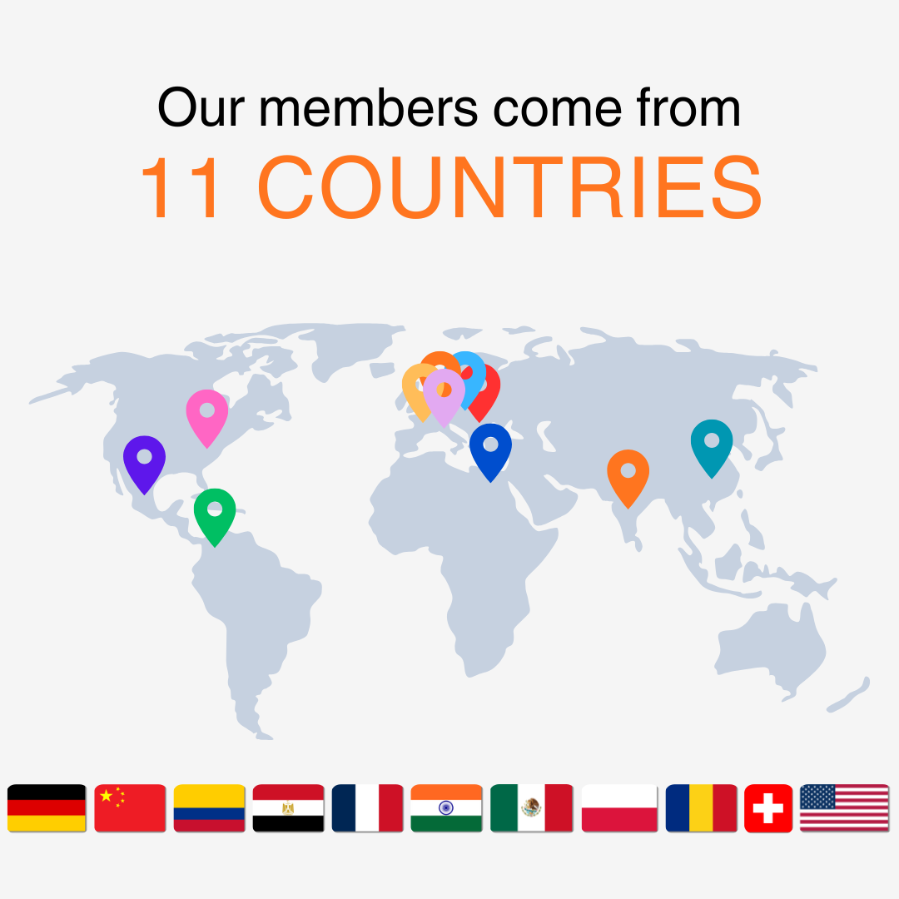

```{r setup_function}
#| echo: false
#| message: false

library(yaml)

# Same as the English version, but: paths go one level up (../),
# and it uses role_de / current_position_de from people.yml when present.
generate_team_grid <- function(status_filter) {
  people <- yaml::read_yaml("../people.yml")
  img_path <- "../img/people"
  placeholder <- "placeholder.jpg"

  pick <- function(de, en) if (!is.null(de) && nzchar(de)) de else en

  selected_people <- Filter(function(x) {
    person_status <- if (is.null(x$status)) "current" else x$status
    person_status == status_filter
  }, people)

  cat('<div class="team-grid">')

  for (person in selected_people) {
    full_img_url <- file.path(img_path, person$img)
    if (!file.exists(full_img_url)) {
      full_img_url <- file.path(img_path, placeholder)
    }

    has_url <- !is.null(person$url) && nzchar(person$url)
    has_email <- !is.null(person$email) && nzchar(person$email)

    # label for email button
    first_name <- if (!is.null(person$email_label) && nzchar(person$email_label)) {
      person$email_label
    } else if (!is.null(person$name) && nzchar(person$name)) {
      strsplit(person$name, "\\s+")[[1]][1]
    } else {
      ""
    }

    # Name as link if profile URL exists (NO wrapping whole card)
    name_html <- if (has_url) {
      paste0('<a href="', person$url, '" class="team-name-link">', person$name, '</a>')
    } else {
      person$name
    }

    # Optional email button
    email_btn <- ""
    if (has_email) {
      email_btn <- paste0(
        '<a class="team-email-btn" href="mailto:', person$email, '">',
        '✉️ E-Mail an ', first_name,
        '</a>'
      )
    }

    # Current position for alumni
    position_html <- ""
    position <- pick(person$current_position_de, person$current_position)
    if (!is.null(position) && nzchar(position)) {
      position_html <- paste0('<div class="team-position"><em>Heute: ',
                              position, '</em></div>')
    }

    html_out <- paste0(
      '<div class="team-card">',
      '',
      '<div class="team-text">',
      '<strong>', name_html, '</strong>',
      '<div>', pick(person$role_de, person$role), '</div>',
      position_html,
      email_btn,
      '</div>',
      '</div>'
    )

    cat(html_out)
  }

  cat('</div>\n\n')
}
```

## Aktuelle Mitglieder {#current-members}

```{r display_current_members}
#| echo: false
#| message: false
#| results: asis

generate_team_grid("current")
```

## Ehemalige Mitglieder {#alumni-and-past-members}

Über die Jahre hat unser Labor vom Engagement und der Kreativität vieler Studierender und Forschender profitiert. Wir sind stolz auf ihre Erfolge und dankbar für ihren nachhaltigen Beitrag zu unserer Gruppe.

```{r display_alumni}
#| echo: false
#| message: false
#| results: asis

generate_team_grid("alumni")
```
