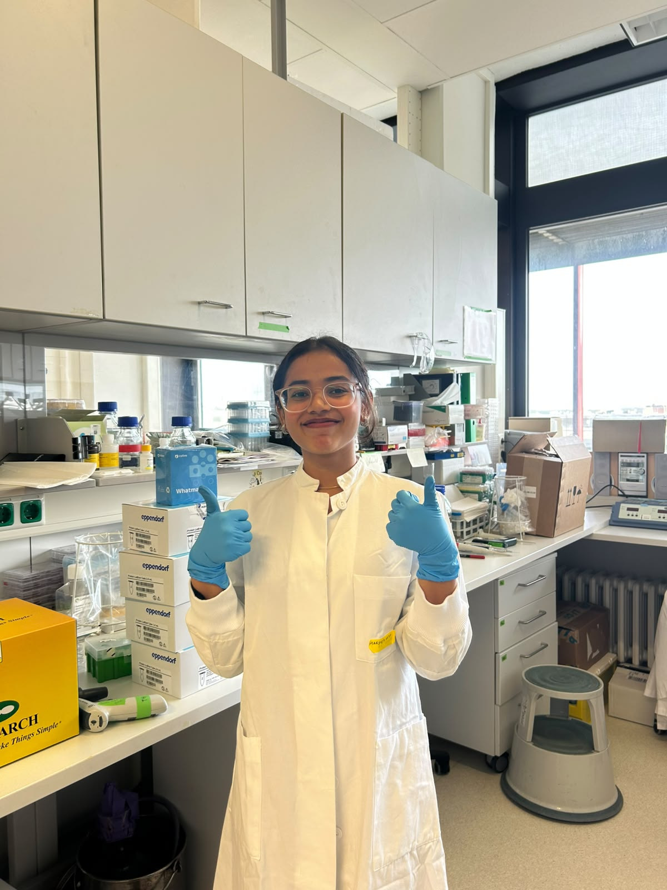

 

We are delighted to welcome **Harshita Gautam**, who has joined the Dölken Lab as a PhD student at the Institute of Virology, MHH!

Originally from New Delhi, India, Harshita began her academic journey with a B.Sc. in Zoology at the University of Delhi. There, a broad training in biology grew into a fascination with the molecular processes that underlie disease, which led her to Hyderabad for an M.Sc. in Biochemistry at the University of Hyderabad. For her master's research, she studied the deubiquitinase activity of the MPN-domain-containing protein MPND. This was her first encounter with ubiquitin-dependent regulation and the way proteins shape cellular processes.

After graduating, Harshita stayed at the University of Hyderabad as a Project Associate in the Molecular Pathogenesis Laboratory, where she moved into virology. Her work there focused on host–virus interactions during HIV-1 infection, including the non-canonical functions of karyophilic proteins and interactions between the viral capsid and mitochondria.

At MHH, Harshita brings these two threads together. Working with Thomas Hennig, she is studying the deubiquitinase activity of the HSV-1 protein pUL36 and how it reshapes host ubiquitin signalling and the DNA damage response. Her project aims to identify the cellular proteins targeted by this viral enzyme and to understand how these interactions affect DNA repair and viral replication.

We're excited to have Harshita on board and look forward to the science ahead.
Welcome to Hannover, Harshita! 🎉

<!--Leave this part as is-->
[← Return to News Overview](../news.qmd){.btn .btn-orange .btn-sm role="button"}
[← Return to Homepage](../index.qmd){.btn .btn-orange .btn-sm role="button"}